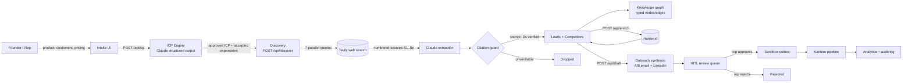

# Pipelight: System Design & Architecture

## 1. Overview

Pipelight is a closed-loop GTM engine: **intake → ICP → discovery → graph → enrichment → outreach → human approval → pipeline → analytics**. Each stage reads the output of the previous one from a single shared workspace, so context such as signals, personas and sources is never re-typed or lost between tools.



## 2. Architecture tiers

| Tier | Component | Implementation |
|---|---|---|
| Reasoning & synthesis | LLM | `claude-opus-5-5` via `@anthropic-ai/sdk` `messages.parse` with Zod-validated **structured outputs** (`src/lib/claude.ts`). Effort is tuned per task: `medium` for ICP and extraction, `low` for copy |
| Discovery & search | Live web | Tavily Search API (`src/lib/tavily.ts`), parallel queries, URL de-duplication |
| Enrichment | Contacts | Hunter.io Domain Search: emails, verification status, LinkedIn, persona ranking |
| Knowledge graph | Graph model | Typed nodes and edges derived from the workspace (`src/components/GraphView.tsx`) |
| Messaging | Dispatch | Sandbox outbox behind the HITL gate (`approveAndSend` in `src/lib/actions.ts`) |
| Frontend | UI | Next.js 16 App Router, Tailwind 4, Zustand (persisted per browser) |
| API | Server | Next.js route handlers in `src/app/api/*`. API keys stay server-side and never reach the browser |

## 3. Module design

### 3.1 ICP engine (`/api/icp`)
- **Input:** free-text product description, existing customers and wins, pricing.
- **Output schema (Zod-enforced):** `industries[] {name, naics, confidence}`, `companySize {headcount, revenue, confidence}`, `personas[] {title, seniority, why, confidence}`, `triggers[] {event, confidence}`, `negativeSignals[]`, `geographies[]`, `expansions[] {segment, reasoning, confidence}`, plus **`searchQueries[]`** and **`competitorQueries[]`**.
- **Confidence semantics:** the system prompt tells the model to lower confidence when it extrapolates beyond what the intake states. In practice, fields stated in the intake land at 0.85–0.95 and extrapolations at 0.45–0.6.
- **Expansion loop:** the rep accepts or dismisses each adjacent segment. Accepted segments inject an extra discovery query, so the rep's choice directly changes the search space.

### 3.2 Discovery with a citation guard (`/api/discover`)
1. **Planner:** runs 5 ICP queries and 2 competitor queries in parallel through Tavily.
2. **Corpus build:** results are de-duplicated by URL and labeled `S1…Sn` with title, URL and snippet.
3. **Builder:** Claude extracts leads, people, signals and competitors. Every item **must reference a source ID** and the prompt forbids invented facts. Accounts matching negative signals are returned in `rejected[]` with a reason.
4. **Reviewer (deterministic):** the server maps source IDs back to retrieved URLs. Any lead with no valid source is **dropped**, and any signal, person or competitor citing an unknown ID is removed. The model cannot invent a URL because URLs come only from the retrieval set.
5. **Domain resolution:** leads without a domain trigger a targeted search. A candidate domain is accepted only if it is not a directory or job board *and* its hostname contains a distinctive token from the company name.
6. **Scoring:** `fitScore` 0–100 (ICP fit plus signal intent) maps to tiers: **A ≥ 75, B ≥ 55, C < 55**.

### 3.3 Enrichment (`/api/enrich`)
- Hunter domain search (personal emails only) returns contacts. They are ranked by persona keyword match (+4), seniority (executive +3, senior +2) and Hunter confidence.
- Verification is mapped to UI states: `verified`, `unconfirmed` (accept-all or unknown), `risky`.
- Contacts already cited during discovery are merged in, and duplicates are removed by name.

### 3.4 Outreach synthesis (`/api/draft`)
- Each contact gets three drafts in one structured call: **email A**, **email B** (a forced different angle for split testing) and a **LinkedIn note** (≤ 280 characters).
- Rules: open with a real signal from the provided list only, one value proposition, one low-friction question as the CTA, under 110 words, tone set by persona seniority. `signalsUsed[]` is returned and shown as chips so reviewers can verify grounding.

### 3.5 Human-in-the-loop gateway
- All drafts enter `pending`. Only a rep action changes their state: edit (sets `editedByRep`), approve, or reject.
- Approving sends that draft to the sandbox outbox, auto-rejects the sibling variant on the same channel, and moves the lead `Matched → Contacted`. The approval is logged as a **Rep** action; the dispatch and stage change are logged as **AI** actions.
- An email cannot be approved without an enriched email address.

### 3.6 Pipeline, attribution & analytics
- Stages: `Matched → Contacted → Replied → Meeting Booked → Closed Won | Closed Lost`.
- **Attribution:** every action writes an `AuditEvent {ts, actor: ai|rep, action, detail, leadId}`. Kanban cards show who made the last stage change.
- **Analytics:** stage-to-stage conversion, contact and reply rates by industry and by tier/size, and A/B reply rates per variant and angle.

### 3.7 Usage-based billing (Flexprice)
- **Meters:** three metered features with COUNT aggregation, created by `scripts/flexprice-setup.mjs`: `lead_enriched` (5 credits), `outreach_sent` (1 credit), `graph_query` (1 credit).
- **Accounts:** on first visit, `/api/billing` creates a Flexprice customer (`external_id = pipelight-ws-<workspace>`) and a prepaid USD wallet seeded with 40 credits (`conversion_rate` $0.08 per credit).
- **Ingestion:** `POST /events` from the server. `lead_enriched` is sent by `/api/enrich` after a successful lookup. `outreach_sent` is sent on approved dispatch and `graph_query` on node inspection.
- **Enforcement:** Flexprice meter aggregation is eventually consistent (it lags a few seconds), so enforcement uses a **credit ledger stored on the Flexprice wallet** (`metadata.credits_used`, updated read-after-write on every charge). Before calling Hunter, `/api/enrich` checks `remaining = wallet credit balance − ledger`. If that is below the enrichment price, it returns **402 `insufficient_credits`** and the expensive pipeline never runs. Meter usage from `POST /events/usage/meter` is used for reporting.
- **Top-up:** `POST /wallets/{id}/top-up` (a demo credit grant). **Cost allocation:** the Billing tab maps credits and dollars to each lead (enrichment plus messages sent).
- Prepaid wallet drawdown through a Flexprice plan or subscription is the production next step. The prototype enforces the balance in-app from Flexprice's metered data.

## 4. Knowledge graph ontology

| Node | Key properties |
|---|---|
| `Product` | the seller's offering |
| `Company` | name, domain, industry, sizeTier, fitScore, tier, stage |
| `Person` | name, title, email, emailStatus, linkedin |
| `Signal` | text, type (funding, hiring, exec_hire, expansion, tech_change, …), source |
| `Competitor` | name, category (direct, indirect, alternative), pricing, positioning |

| Edge | From → To |
|---|---|
| `matched_to` | Product → Company |
| `works_at` | Person → Company |
| `has_signal` | Company → Signal |
| `competes_with` | Competitor → Product |
| `uses` | Company → Competitor |
| `contacted_via` | Company → Person (after an approved dispatch) |

**Multi-hop queries implemented:**
- **Competitor displacement:** `(c:Company)-[:uses]->(x:Competitor)-[:competes_with]->(p:Product)`
- **Co-mention:** two companies cited by the same source document, giving shared context for an opener
- **Signal cluster:** companies sharing a signal type, so one sequence can cover the cohort

**Equivalent Cypher (Neo4j port):**
```cypher
MATCH (c:Company)-[:uses]->(x:Competitor)-[:competes_with]->(:Product {id:$me})
RETURN c.name, x.name ORDER BY c.fitScore DESC;

MATCH (a:Company)-[:has_signal]->(s1:Signal), (b:Company)-[:has_signal]->(s2:Signal)
WHERE a <> b AND s1.type = s2.type
RETURN s1.type, collect(DISTINCT a.name) AS cohort;
```
The prototype computes these in memory. Moving to Neo4j or Kùzu is a storage swap with the same ontology. `previously_employed_at` warm paths need employment-history data that the current enrichment sources don't provide.

## 5. Reasoning loop (agent roles)

| Role | Responsibility | Where |
|---|---|---|
| **Planner** | Parses intake, defines the ICP, generates search queries, dispatches discovery | `/api/icp`, `runDiscovery` |
| **Builder** | Extraction, domain resolution, enrichment, drafting | `/api/discover`, `/api/enrich`, `/api/draft` |
| **Reviewer** | Citation guard, negative-signal rejection, verification states, HITL gate | `/api/discover` post-processing, Review queue |

Every step streams into the **Agent Thinking** panel.

## 6. Security & data handling
- API keys load from `.env.local` (ignored by git) and are used only in server route handlers. They never reach the browser.
- Prospect data stays in the visitor's own browser (localStorage) and is not stored server-side.
- No outbound message is sent without a human approval.

## 7. Known limitations & next steps
- Real dispatch (SendGrid or Gmail API) with webhooks for replies and bounces.
- Persistent multi-user store (Postgres) and a native graph DB (Neo4j or Kùzu) with scheduled signal refresh.
- Discovery currently takes about 1 minute; streaming partial results would improve perceived speed.
